# Porsuk

## Türkçe

### Dünya genelinde kamp alanı, karavan alanı ve karavan durağı keşfet
Çadırını kuracak, karavanını park edecek ya da geceyi geçirecek bir yer bul; yolunu planla.

**iOS 17+ · Yaklaşık 180.000 kamp alanı · Çevrimdışı arama · Reklamsız · Hesap gerekmez · Türkçe ve İngilizce**

#### Uygulamayı keşfet

| | | |
|---|---|---|
| 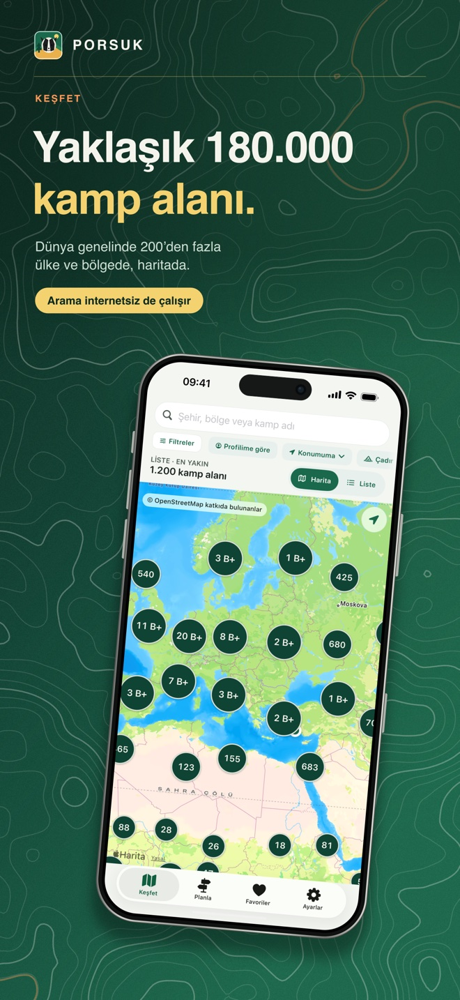 | 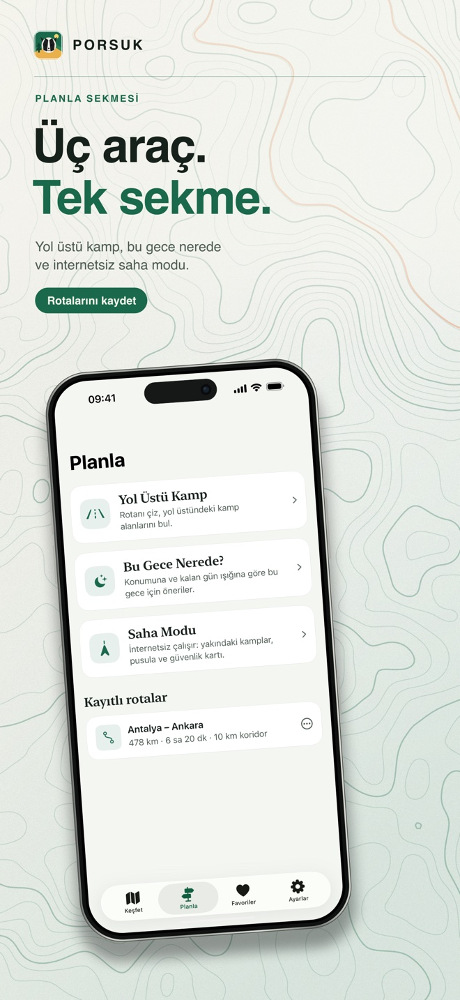 | 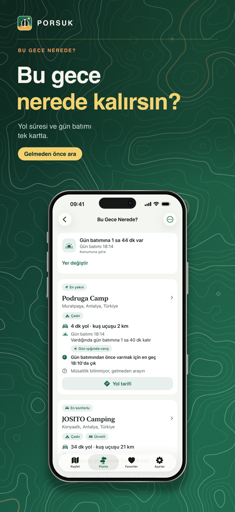 |
| 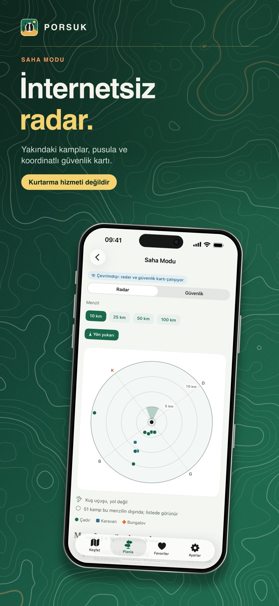 | 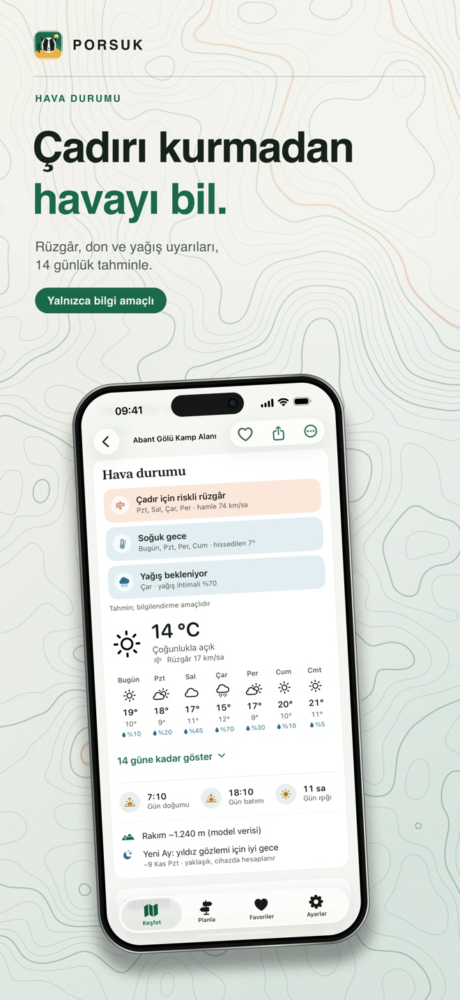 | 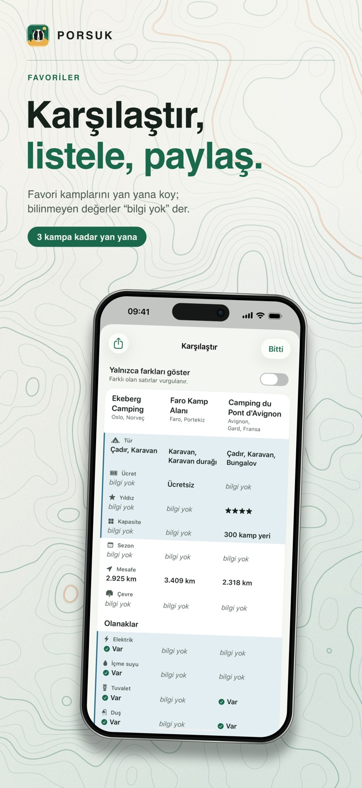 |

#### Neler yapabilirsin

- **Keşfet:** harita ve liste araması, filtreler, kamp profilin (araç, yol arkadaşları, ihtiyaçlar), kayıtlı filtreler ve "Konumuma" mesafe seçenekleri. Arama cihazdaki katalogla internetsiz çalışır.
- **Planla:** *Yol Üstü Kamp* (durakları yaz, rota Apple Haritalar ile hesaplanır, yol üstündeki kamp alanları listelenir; GPX içe aktarma, kayıtlı rotalar), *Bu Gece Nerede?* (yakındaki seçenekler, yolculuk süresi, gün batımı) ve internetsiz *Saha Modu* radarı ile güvenlik kartı.
- **Favoriler:** harita görünümü, listeler ("Gitmek istediklerim", "Gittiklerim", özel listeler), 3 kamp alanına kadar karşılaştırma, listeyi bağlantı, metin ya da GPX olarak paylaşma.
- **Kamp alanı sayfası:** 14 günlük hava durumu ve kamp uyarıları (bilgilendirme amaçlı), kamp alanının çevresindeki market, yakıt, eczane ve benzeri hizmetler, GPX / KML dışa aktarma ve diğer harita uygulamalarına aktarma.
- **Eksik kamp alanı ekle:** OpenStreetMap'e eklemek için üç adımlık rehber.

Porsuk müsaitlik ya da rezervasyon göstermez; ücret yalnızca kaynak veride varsa gösterilir ve bilinmeyen bilgi hiçbir zaman "yok" diye gösterilmez. Kamp alanı bilgileri eksik ya da güncelliğini yitirmiş olabilir; yola çıkmadan önce kamp alanıyla görüş. Saha Modu bir kurtarma hizmeti değildir: acil durumda yerel acil durum numarasını ara.

#### Son sürüm: 1.1.0 (9)

Katalog **179.736 kamp alanı** içerir (veri sürümü 2026.10.21.1), Türkiye'de yaklaşık 1.800 (1.804). Yeni: Planla sekmesi, kamp profili, kamp hava durumu asistanı, Favoriler 2.0, "Çevrede" hizmetleri, GPX / KML dışa aktarma, bölge aramaları (Ege, Marmara, Karadeniz, Trakya... bölgenin illeriyle) ve kamp alanı olmayan noktaların katalogdan çıkarılması. Ayrıntılar için [değişiklik geçmişine](CHANGELOG.html) bak.

Bu notlar proje durumunu anlatır; App Store'daki güncel yayın durumunu doğrulamaz.

#### Gizlilik ve veri kaynakları

Porsuk verilerini cihazında tutar: reklam yok, izleme yok, kullanım analizi yok, geliştirici veri toplamaz. Konum yalnızca bir özelliğe dokunduğunda istenir; cihazından yalnızca senin başlattığın işlemlerde çıkar (örneğin rota hesaplarken başlangıç noktası Apple Haritalar'a, bir kamp alanının hava durumunda o kamp alanının koordinatı Open-Meteo'ya gider).

- [Gizlilik politikası](PRIVACY.html)
- Kamp alanı verileri: © OpenStreetMap katkıda bulunanlar (ODbL 1.0), Overture Maps Places, Atout France, Yeni Zelanda Koruma Bakanlığı (DOC), Parks Canada, ABD Rekreasyon Bilgi Veritabanı (RIDB), TFIS NRW (Land NRW); yer adları için GeoNames. Atıflar ve lisanslar uygulamada Ayarlar > Veri kaynakları ve lisanslar bölümündedir.
- Hava durumu: [Open-Meteo.com](https://open-meteo.com/) (CC BY 4.0). Haritalar ve rotalar: Apple Haritalar.
- ODbL 1.0 altındaki kamp alanı veritabanının bir kopyası, [son sürümde](https://github.com/emircanby/porsuk-support/releases/latest) dosya olarak yayımlanır: `porsuk-catalog-2026.10.21.1.sqlite.gz` (uygulamadaki SQLite veritabanı), `porsuk-campsites-2026.10.21.1.csv.gz` (CSV), `ATTRIBUTION.txt` ve `SHA256SUMS`.

#### Destek

Sorular, sorun bildirimleri, kamp alanı düzeltmeleri ve gizlilik talepleri için [sorun aç](https://github.com/emircanby/porsuk-support/issues) ya da **emircanby@gmail.com** adresine yaz. Uygulamada Ayarlar > Sorun bildir, uygulama, iOS ve veri sürümünü içeren hazır bir e-posta açar.

Veri OpenStreetMap'ten geldiği için en iyi düzeltme [openstreetmap.org](https://www.openstreetmap.org/) üzerinde yapılır; bu, veriyi kullanan her uygulamaya ulaşır. Bir kamp alanını işletiyorsan ve iletişim bilgilerinin kaldırılmasını ya da düzeltilmesini istiyorsan e-posta gönder; talep sonraki veri sürümünde uygulanır. Yanlış bir yer için kamp alanının adını, şehrini, uygulama sürümünü ve neyin düzeltilmesi gerektiğini yaz. Herkese açık sorunlara kişisel bilgi yazma.

---

## English

### Discover campsites, caravan sites and motorhome stopovers around the world
Find a place to pitch a tent, park an RV or stay the night, and plan your way there.

**iOS 17+ · Nearly 180,000 campsites · Offline search · No ads · No account needed · English and Turkish**

#### Explore the app

| | | |
|---|---|---|
| 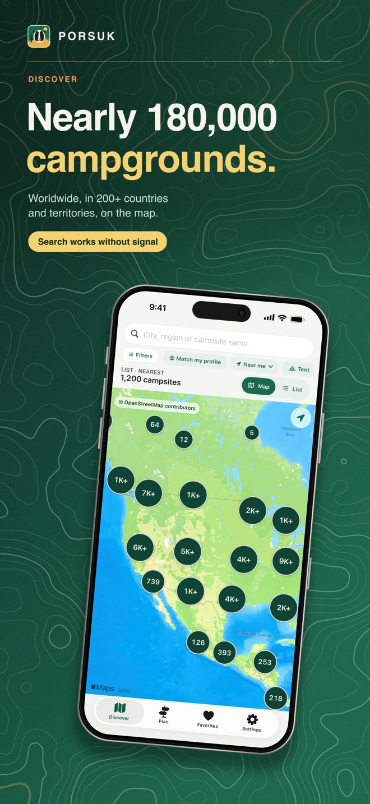 | 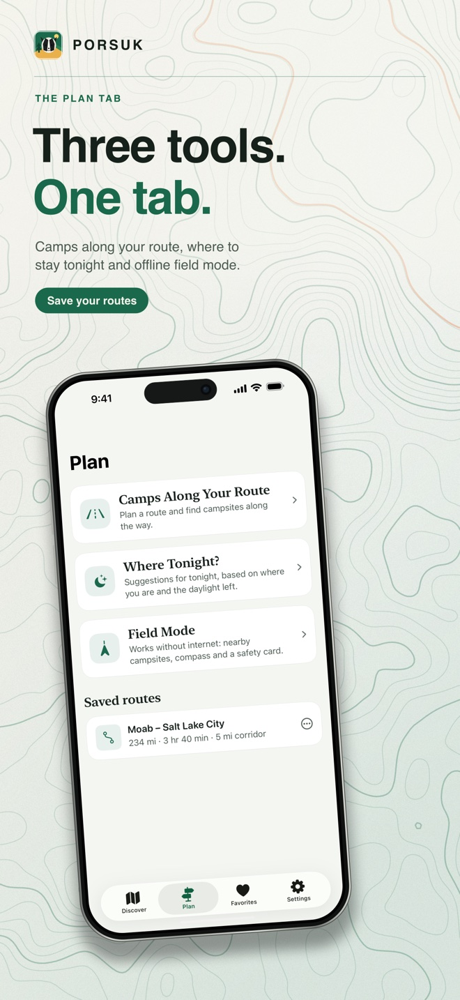 | 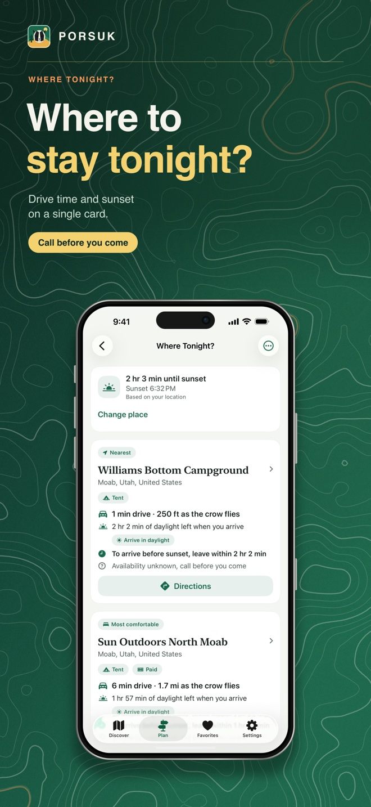 |
| 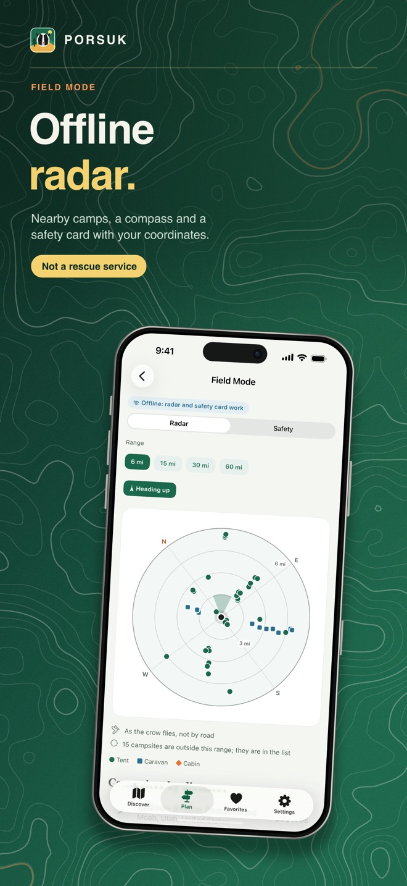 | 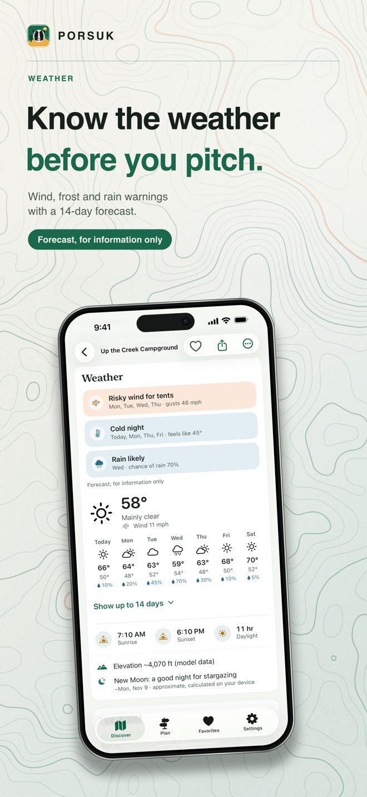 | 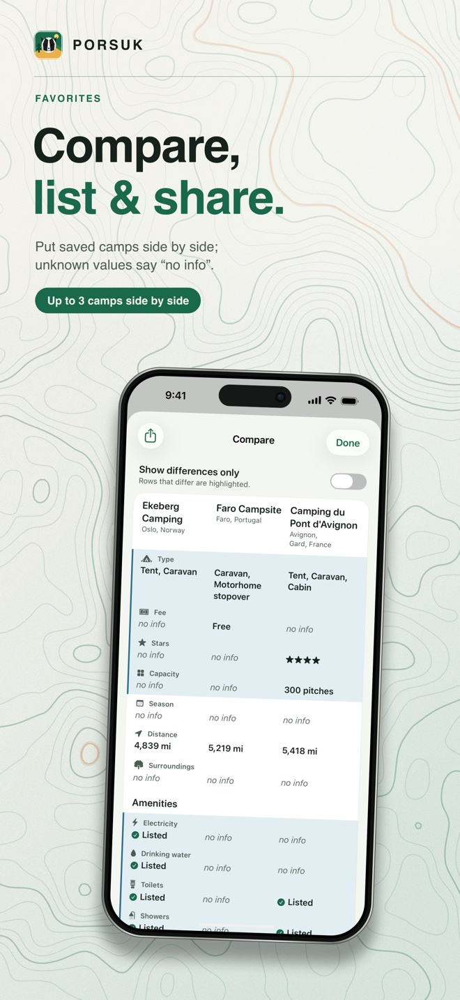 |

#### What you can do

- **Discover:** map and list search, filters, a camping profile (vehicle, companions, needs), saved filters and "Near me" distances. Search runs on the catalog stored on your device, so it works offline.
- **Plan:** *Camps Along Your Route* (enter stops, Apple Maps calculates the route and the campsites along it are listed; GPX import, saved routes), *Where Tonight?* (nearby picks with travel time and sunset) and an offline *Field Mode* radar with a safety card.
- **Favorites:** a map view, lists ("Want to go", "Been there", custom lists), comparing up to 3 campsites, sharing a list as a link, text or GPX.
- **Campsite page:** a 14-day forecast and camp advisories (information only), shops, fuel, pharmacies and more around the campsite, GPX / KML export and hand-off to other maps apps.
- **Add a missing campsite:** a three-step guide for adding it to OpenStreetMap.

Porsuk shows no availability or booking; a fee is shown only when the source data has one, and unknown information is never shown as "no". Campsite information can be incomplete or out of date: check with the campsite before you travel. Field Mode is not a rescue service: in an emergency call the local emergency number.

#### Latest version: 1.1.0 (9)

The catalog holds **179,736 campsites** (dataset 2026.10.21.1), about 1,800 (1,804) of them in Türkiye. New: the Plan tab, the camping profile, the camp weather assistant, Favorites 2.0, "Around here" services, GPX / KML export, region searches by province (Aegean, Marmara, Black Sea, Thrace...) and the removal of points that are not campsites from the catalog. See the [change history](CHANGELOG.html) for details.

These notes describe the project snapshot; they do not confirm the current App Store release status.

#### Privacy and data sources

Porsuk keeps your data on your device: no ads, no tracking, no usage analytics, and the developer collects no data. Location is requested only when you tap a feature that needs it and leaves the device only in actions you start (for example the start point of a route goes to Apple Maps, and a campsite's coordinates go to Open-Meteo when you view its weather).

- [Privacy policy](PRIVACY.html)
- Campsite data: © OpenStreetMap contributors (ODbL 1.0), Overture Maps Places, Atout France, New Zealand Department of Conservation (DOC), Parks Canada, the US Recreation Information Database (RIDB) and TFIS NRW (Land NRW); place names use GeoNames. Attributions and licences are in the app under Settings > Data sources & licenses.
- Weather: [Open-Meteo.com](https://open-meteo.com/) (CC BY 4.0). Maps and routes: Apple Maps.
- A copy of the campsite database, published as open data under ODbL 1.0, is attached to the [latest release](https://github.com/emircanby/porsuk-support/releases/latest): `porsuk-catalog-2026.10.21.1.sqlite.gz` (the SQLite database as it ships in the app), `porsuk-campsites-2026.10.21.1.csv.gz` (CSV), `ATTRIBUTION.txt` and `SHA256SUMS`.

#### Support

For questions, problem reports, campsite corrections and privacy requests, [open an issue](https://github.com/emircanby/porsuk-support/issues) or email **emircanby@gmail.com**. In the app, Settings > Report a problem prepares an email that contains the app, iOS and dataset versions.

Because the data comes from OpenStreetMap, the best fix is at [openstreetmap.org](https://www.openstreetmap.org/): it reaches every app that uses the data. If you run a campsite and want its contact details removed or corrected, write to the address above; the request is applied in a following data release. For a wrong location, include the campsite name, city, app version and what needs correcting. Do not include personal information in public issues.

Developer / Geliştirici: **Emircan Yayla** · © 2026. All rights reserved.
